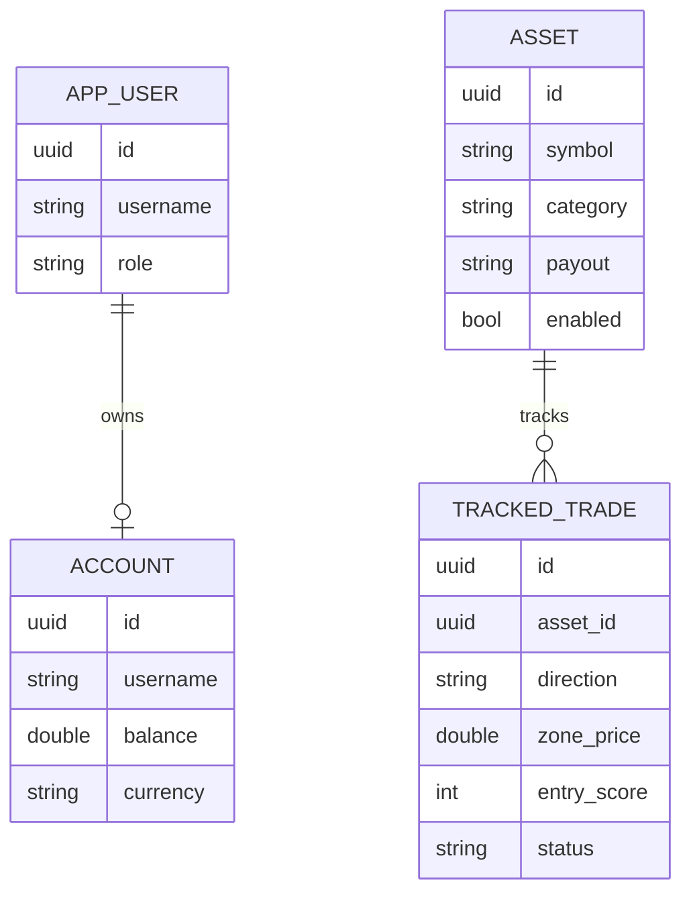

# Ascendisk — binary-options signal indicator

Ascendisk is a Spring Boot + React application that turns live 1-minute (M1) forex data into
decision-support signals for binary-options traders. It computes a convergence **precision score**
(EMA 9/21 trend, RSI 14 momentum, entry-zone strength) and only lights a directional signal once the
score reaches the **75%** threshold. Orders are always placed manually on the broker; Ascendisk only
helps decide and then tracks them.

---

## Features

- Live **M1 candles** pulled from Yahoo Finance.
- **Precision score** (0-100) built from three confirmation layers.
- **75% filter**: the signal stays `NEUTRAL` until the score reaches the threshold.
- **Anti-OTC weekend filter**: analysis is blocked from Friday 21:00 UTC to Sunday 21:00 UTC and the UI
  shows *market closed (OTC)*.
- **Entry zone**: price, touch count and distance to the current price; signals are sorted by distance.
- **Payout** display, defaulting to `-` when the broker rate cannot be retrieved.
- **JWT authentication** with `ADMIN` and `TRADER` roles.
- **Single-page React UI** (signals / tracking / account / assets) served by the application itself.
- **Manual trade tracking** with real-time M1 charts.

## Precision score

| Layer                  | Weight    | Rule                                                        |
| ---------------------- | --------- | ----------------------------------------------------------- |
| Trend (EMA 9 / EMA 21) | 40        | EMA 9 > EMA 21 → BUY, EMA 9 < EMA 21 → SELL                 |
| Momentum (RSI 14)      | 40        | BUY and RSI < 45 → +40, SELL and RSI > 55 → +40             |
| Momentum (secondary)   | 20        | BUY and RSI < 60 → +20, SELL and RSI > 40 → +20             |
| Entry zone             | up to 20  | +5 per touch of the zone, capped at 4 touches               |

`score = min(100, sum)`. A signal is emitted (`direction = trend`) only when `score >= 75` **and** the
market is open; otherwise `direction = NEUTRAL`. An empty result is always neutral.

## Architecture

```
api.poja.app
├── endpoint/rest/controller   REST controllers (auth, assets, signals, candles, trades, account)
├── endpoint/rest/model        request / response records
├── service                    business logic (signal scoring, market data, trades, accounts)
├── mapper                     domain <-> entity <-> DTO conversion
├── market                     Yahoo Finance client and the OTC calendar
├── model                      domain records and enums
├── repository                 Spring Data JPA repositories and entities
└── security                   JWT provider, filter and security chain
```

Flow: **Yahoo Finance (M1)** → `SignalService` → `SignalScoringService` (EMA/RSI/zone) →
`GET /signals` → React UI.

Data model:



## Getting started

Requirements: **Java 21**. No Node.js is needed — the React UI is loaded from a CDN.

```bash
./gradlew bootRun
```

The application then serves the UI on `http://localhost:8080/`, the REST API under the same origin and
the Swagger UI on `http://localhost:8080/swagger-ui.html`.

Database and cloud settings (PostgreSQL, AWS region/bucket/queues) are injected through environment
variables, exactly as they are set on the POJA environment.

## Tests

```bash
./gradlew test
```

Unit tests run standalone. Integration tests (classes ending with `IT`) spin up a disposable
PostgreSQL through Testcontainers, so **Docker must be running**. The JaCoCo report is generated in
`build/reports/jacoco`.

## Formatting

```bash
./format.sh     # or format.bat on Windows
```

The CI runs `./format.sh && git diff --exit-code`, so code must be formatted before pushing.

## API

The full OpenAPI specification lives in [`doc/api.yml`](doc/api.yml); ready-to-copy `curl` requests are
in [`demo/demo-requests.md`](demo/demo-requests.md).

| Method | Path                      | Access        |
| ------ | ------------------------- | ------------- |
| POST   | `/auth/login`             | public        |
| GET    | `/ping`                   | public        |
| GET    | `/assets`                 | authenticated |
| POST   | `/assets`                 | ADMIN         |
| PUT    | `/assets/{symbol}`        | ADMIN         |
| GET    | `/signals`                | authenticated |
| GET    | `/signals/{symbol}`       | authenticated |
| GET    | `/assets/{symbol}/candles`| authenticated |
| GET    | `/trades`                 | authenticated |
| POST   | `/trades`                 | authenticated |
| GET    | `/trades/{tradeId}`       | authenticated |
| PUT    | `/trades/{tradeId}`       | authenticated |
| GET    | `/account`                | authenticated |
| PUT    | `/account`                | authenticated |

## Speculations / next steps

- **Push updates** over WebSocket / SSE instead of the current 5s polling on `/signals`.
- **Sound alerts** when the score crosses 75% for a watched asset.
- **More instruments**: the asset model already supports `CRYPTO`, `COMMODITY` and `INDEX`.
- **Live payout**: extract the payout rate from the broker instead of storing it per asset.
- **Backtesting** of the scoring rules against historical M1 data.
